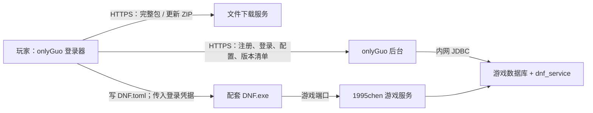

> 历史记录：描述当时的分析、路径和验收范围；当前部署请从仓库 README 与 deploy 入口开始。

# 1995chen + onlyGuo：注册、登录与自动更新兼容性审计

审计日期：2026-10-14。目标：玩家下载发行包后，无需填写 IP、修改配置或手动建号，能自行注册、登录并安装更新。

**结论：可以作为集成方案继续开发，但当前源码不能原样作为对外发行成品。** HTTP 接口基本配套；明确的改动集中在数据库配置、注册与后台权限、密钥生命周期、更新可靠性和发行配置。实际游戏二进制是否能完成登录，仍需用选定的客户端、PVF、服务端镜像联调确认。

本次检查了三个仓库的核心启动脚本、注册登录接口、数据库访问、配置下发、更新器和构建文件；未执行完整项目构建、未连接实际游戏数据库、未运行 DNF 客户端。本文的“已确认”指源码或离线复现，不代表已通过开服验收，也不是对全部管理功能的完整安全审计。没有修改上游源码或部署任何服务。

## 1. 固定检查版本

| 项目 | 固定提交 | 提交日期 UTC |
|---|---|---|
| 1995chen/dnf | [08f724c25b12](https://github.com/1995chen/dnf/commit/08f724c25b12748f8eb4bf11b24a90accfc3b223) | 2026-10-11 |
| onlyGuo/DNFLogin | [7f82eea909ec](https://github.com/onlyGuo/DNFLogin/commit/7f82eea909ec01b5a9cf36ada176bf373316136b) | 2026-02-12 |
| onlyGuo/dnf-server-public | [4b03fe72c288](https://github.com/onlyGuo/dnf-server-public/commit/4b03fe72c288e2c96db491640c7eaefe45c8c5b5) | 2026-06-18 |

源码提交与预构建 Docker 镜像、网盘客户端不是同一个版本标识。落地时还要记录镜像 digest、DNF.exe/DLL/PVF 的哈希，不能只记录仓库分支。

## 2. 这套方案应怎样连接



onlyGuo 后台承担注册和生成游戏登录凭据的工作。它不是把请求转给 1995chen 默认的统一网关；不要把统一登录器的版本号、网关连接密码当作 onlyGuo 的认证配置。

源码中的 HTTP 对应关系如下：

| 玩家功能 | 登录器调用 | 后台现状 |
|---|---|---|
| 注册验证码 | GET /api/v1/vc/img/{index} | 有，但大小写处理有缺陷 |
| 注册 | POST /api/v1/client/register | 有，会写游戏账号和关联表，但有默认推荐人及权限字段问题 |
| 登录 | POST /api/v1/client/login | 返回 JSON token；由后台私钥生成游戏凭据 |
| 游戏地址与内辅配置 | GET /api/v1/admin/assist/config-text | 有，匿名可读；登录器保存为 DNF.toml |
| 首次完整客户端下载 | GET /api/v1/client/full-package | 有 version/downloadUrl，以及可选 md5 |
| 增量更新列表 | GET /api/v1/client/version/{currentVersion} | 有，但版本比较与客户端排序需修 |
| 背景图 | GET /api/v1/client/big-pic-list | 有 |

依据：[客户端 API](https://github.com/onlyGuo/dnf-server-public/blob/4b03fe72c288e2c96db491640c7eaefe45c8c5b5/src/main/java/com/aiyi/game/dnfserver/controller/ClientAccountController.java#L43)、[登录器接口及配置下发](https://github.com/onlyGuo/DNFLogin/blob/7f82eea909ec01b5a9cf36ada176bf373316136b/LoginWindow.xaml.cs#L48)、[更新器接口](https://github.com/onlyGuo/DNFLogin/blob/7f82eea909ec01b5a9cf36ada176bf373316136b/MainWindow.xaml.cs#L49)。

**这里的自动更新是 ZIP 文件覆盖更新，不是二进制差分。登录器自身更新也没有独立实现。** 当前启动顺序是检查/下载游戏资源，再打开登录窗口；若想先注册再下载大客户端，还需要调整界面流程。

## 3. 必须先处理的阻断项

### A. 数据库：默认大区库名不匹配

onlyGuo 注册写入了 `taiwan_cain_2nd.member_avatar_coin`，管理查询使用 `taiwan_cain` 系列库和 `taiwan_login.login_account_3`。1995chen 的 `SERVER_GROUP=3` 默认对应 siroco，若不另设 `SERVER_GROUP_DB`，数据库命名就不一致。

**建议第一版固定：**

```yaml
environment:
  SERVER_GROUP: "3"
  SERVER_GROUP_DB: "cain"
  PUBLIC_IP: "<游戏服务器对外 IPv4>"
```

这仍然是编号 3 的大区，只是使用 cain 数据库名；不等于把大区编号改成 1。onlyGuo 的 JDBC 要能在同一个 MySQL 实例访问 `d_taiwan`、`taiwan_login`、`taiwan_billing`、`taiwan_cain*` 和 `dnf_service`。第一版不要启用游戏主库、大区库分属不同 MySQL 实例的拓扑，否则要改 onlyGuo 数据源与跨库 SQL。

后台业务库先保留 `dnf_service`：虽然 entrypoint 能替换建库名，实体映射和部分 SQL 仍写死这个名称，不能只改 JDBC 的库名。

现有注册逻辑已经补写 member_info、member_white_account、member_login、cash_cera、cash_cera_point、member_avatar_coin，**不用从零重写注册系统**。但需要对照实际数据库的列、默认值、唯一约束和表引擎验收；不能只凭 @Transactional 就假定所有游戏表支持回滚。注册默认送 1000 点券也应改成你的明确配置。

依据：[大区与库名选择](https://github.com/1995chen/dnf/blob/08f724c25b12748f8eb4bf11b24a90accfc3b223/build/dnf_data/docker-entrypoint.sh#L99)、[官方 compose 配置](https://github.com/1995chen/dnf/blob/08f724c25b12748f8eb4bf11b24a90accfc3b223/deploy/dnf/docker-compose/basic/docker-compose.yaml#L15)、[注册关联表](https://github.com/onlyGuo/dnf-server-public/blob/4b03fe72c288e2c96db491640c7eaefe45c8c5b5/src/main/java/com/aiyi/game/dnfserver/service/impl/AccountServiceImpl.java#L155)、[编号 3 的登录表](https://github.com/onlyGuo/dnf-server-public/blob/4b03fe72c288e2c96db491640c7eaefe45c8c5b5/src/main/java/com/aiyi/game/dnfserver/dao/AccountDao.java#L65)。

### B. 注册与管理权限：必须一起修

1. 普通注册没填推荐人时，后台自动填 `123123`，然后查找这个账号；新库没有该账号会报“推荐人账号不存在”。应改为推荐人可选，不能把创建这个固定账号当作长期修复。
2. 注册接口直接把 JSON 绑定到 AccountVO，其中包含 admin、parentUid、uid、vip 等持久化字段，普通注册路径没有重置这些字段，随后将对象交给 DAO 保存。这是明确的越权字段绑定风险；实际 ORM 对这些字段的写入效果尚未做数据库实测。
3. 管理后台登录仅拒绝 `非 admin 且 parentUid != 0` 的账号，意味着非 admin、parentUid=0 的账号也能通过这条检查。**只取消推荐人而不修此处，会把新玩家落入允许进入管理后台的条件。**
4. 全局拦截器主要检查是否登录，不统一检查管理员角色；完整包配置保存方法缺少类似版本管理方法的 admin 校验。数据库工具接口还允许已认证调用者提交 SQL，代码本身没有额外管理员判断。

**修改方式：**

- 新建 RegisterRequest，只接收账号、密码、验证码索引、验证码和可选推荐人。
- 服务端创建 AccountVO，明确设置普通玩家权限、默认 VIP；UID 由数据库生成，parentUid 只来自已校验的推荐关系。
- 将后台访问权改为显式角色判断。第一版若只有一个管理者，可统一要求 admin=true；推荐关系不参与授权。
- 对全部管理写接口做服务端授权；生产构建关闭通用 SQL 执行接口及测试接口。
- 初始管理员由受控的一次性初始化步骤建立，不通过公共玩家注册接口升级权限。
- 并发注册依赖数据库唯一约束，处理重复账号冲突；验证失败后不留下半注册记录。

这是对外开放前的首要修复项。以上是源码数据流与条件判断审计，没有对任何线上站点进行攻击验证。

依据：[公开注册绑定](https://github.com/onlyGuo/dnf-server-public/blob/4b03fe72c288e2c96db491640c7eaefe45c8c5b5/src/main/java/com/aiyi/game/dnfserver/controller/ClientAccountController.java#L73)、[账号持久化字段](https://github.com/onlyGuo/dnf-server-public/blob/4b03fe72c288e2c96db491640c7eaefe45c8c5b5/src/main/java/com/aiyi/game/dnfserver/entity/AccountVO.java#L18)、[推荐人与保存逻辑](https://github.com/onlyGuo/dnf-server-public/blob/4b03fe72c288e2c96db491640c7eaefe45c8c5b5/src/main/java/com/aiyi/game/dnfserver/service/impl/AccountServiceImpl.java#L115)、[后台登录条件](https://github.com/onlyGuo/dnf-server-public/blob/4b03fe72c288e2c96db491640c7eaefe45c8c5b5/src/main/java/com/aiyi/game/dnfserver/controller/LoginController.java#L52)、[全局认证](https://github.com/onlyGuo/dnf-server-public/blob/4b03fe72c288e2c96db491640c7eaefe45c8c5b5/src/main/java/com/aiyi/game/dnfserver/conf/RequestThreadFilterConf.java#L47)、[完整包配置保存](https://github.com/onlyGuo/dnf-server-public/blob/4b03fe72c288e2c96db491640c7eaefe45c8c5b5/src/main/java/com/aiyi/game/dnfserver/service/impl/ClientLauncherServiceImpl.java#L66)、[SQL 工具接口](https://github.com/onlyGuo/dnf-server-public/blob/4b03fe72c288e2c96db491640c7eaefe45c8c5b5/src/main/java/com/aiyi/game/dnfserver/controller/DatabaseToolsController.java#L37)。

### C. 验证码：照着图片输入大写可能失败

生成器使用数字和大写字母，但缓存时转成小写；注册用区分大小写的 equals，客户端只 Trim、不统一大小写。修复应放在服务端：统一大小写后比较，成功消费验证码，并为注册和验证码接口设置合理限流。

离线示例：图片 AB12，缓存 ab12，按原逻辑提交 AB12 为 false，提交 ab12 为 true。

依据：[验证码生成](https://github.com/onlyGuo/dnf-server-public/blob/4b03fe72c288e2c96db491640c7eaefe45c8c5b5/src/main/java/com/aiyi/game/dnfserver/controller/ValidationCodeController.java#L68)、[验证码比较](https://github.com/onlyGuo/dnf-server-public/blob/4b03fe72c288e2c96db491640c7eaefe45c8c5b5/src/main/java/com/aiyi/game/dnfserver/service/impl/AccountServiceImpl.java#L105)、[用户输入](https://github.com/onlyGuo/DNFLogin/blob/7f82eea909ec01b5a9cf36ada176bf373316136b/RegisterWindow.xaml.cs#L338)。

### D. 密钥与实际游戏客户端：必须成套验收

后台读取 `/app/data/private.key`，按账号 UID 生成 RSA 登录凭据；登录器将凭据作为命令行参数传给 DNF.exe。1995chen 启动时会把 `/data/publickey.pem` 复制到游戏目录。

已用 .NET 解析 1995chen 仓库中的模板公钥，确认是 2048 位 RSA，与 onlyGuo 启动脚本的生成位数一致；这只排除了位数这一项明显不匹配，尚不能证明原生游戏程序接受其凭据。1995chen 初始化脚本会复制仓库内的模板密钥，发行部署必须用自己生成的密钥替换，不能沿用公开模板。两个项目的私钥文件名也不同：onlyGuo 使用 private.key，统一网关使用 privatekey.pem，不应把整个数据目录混用。

需要固定的一套材料：

- 后台持久化保存的私钥；
- 从该私钥导出的公钥，放到游戏容器对应的 /data/publickey.pem；
- 能理解该登录方式和 DNF.toml 的配套 DNF.exe/补丁；
- 与游戏服务端匹配的客户端 PVF 和资源。

**后台私钥不进入玩家发行包。** 游戏端复制公钥后需要重启相关服务并核对实际加载文件。不要混用另一套登录器附带的密钥。

entrypoint 当前在“任意一个密钥文件缺失”时重新生成整对密钥。如果仅删除公钥，已有私钥也会被覆盖，造成游戏端公钥与后台私钥不匹配。应改成：两者都不存在才新建；私钥存在、公钥缺失则重新导出公钥；只有公钥则报错；同时存在则检查配对。

入口默认生成 PKCS#8 私钥，可以优先固定这一格式。登录代码仅剥离 BEGIN PRIVATE KEY 标记；带 BEGIN RSA PRIVATE KEY 的完整 PKCS#1 PEM 不能仅凭工具类里的 fallback 就认定可用，应统一 PEM 解析或先规范化格式。

1995chen README 提到了 DOF7.6 的地址、公私钥和未加密 PVF 注意事项；onlyGuo 配置生成器标识 DOF V7。**这说明集成方向合理，但不证明任意 V7/7.6 客户端包都完全兼容。** 首先用一个固定客户端完成注册、进角色、进频道、进副本，再确定发行基线。

依据：[游戏凭据生成](https://github.com/onlyGuo/dnf-server-public/blob/4b03fe72c288e2c96db491640c7eaefe45c8c5b5/src/main/java/com/aiyi/game/dnfserver/service/impl/AccountServiceImpl.java#L54)、[密钥生成条件](https://github.com/onlyGuo/dnf-server-public/blob/4b03fe72c288e2c96db491640c7eaefe45c8c5b5/entrypoint.sh#L6)、[私钥解析入口](https://github.com/onlyGuo/dnf-server-public/blob/4b03fe72c288e2c96db491640c7eaefe45c8c5b5/src/main/java/com/aiyi/game/dnfserver/utils/RSATool.java#L87)、[PVF/程序/公钥覆盖](https://github.com/1995chen/dnf/blob/08f724c25b12748f8eb4bf11b24a90accfc3b223/build/dnf_data/docker-entrypoint.sh#L234)、[DNF.exe 启动](https://github.com/onlyGuo/DNFLogin/blob/7f82eea909ec01b5a9cf36ada176bf373316136b/LoginWindow.xaml.cs#L367)、[客户端配套说明](https://github.com/1995chen/dnf/blob/08f724c25b12748f8eb4bf11b24a90accfc3b223/README.md)。

### E. 自动更新：版本选择和失败恢复均需修改

| 问题 | 影响 | 建议改法 |
|---|---|---|
| 客户端按 OrdinalIgnoreCase 排版本字符串；后台对 VARCHAR 版本字段作大小比较 | 1.0.10、1.0.11 会排在 1.0.9 前面；后台筛选也有漏包风险 | 前后端统一整数 build 编号；显示版本单独保存；或两端一致实现 SemVer |
| 只检查 Script.pvf 存在 | 缺 DNF.exe、资源缺失也跳过完整包下载 | 安装清单记录必要文件、长度与哈希，增加修复入口 |
| 直接解压覆盖工作目录 | 中途失败出现混合版本，无法恢复 | 下载到固定缓存；校验后解压到暂存区；备份/事务日志替换；失败恢复 |
| 后台虽可返回 md5，客户端响应模型没有该字段，也没有执行校验 | 包损坏或替换无法在应用前可靠识别 | HTTPS + SHA-256 完整性校验；发行版增加签名清单与内置验证公钥 |
| 更新链只有“比当前版本大且启用”的列表 | 停用中间补丁可能遗漏文件；旧版跳级行为不明确 | 清单包含 fromBuild/toBuild；缺链时回退到完整包，或提供明确的累计包 |
| 只有覆盖，没有删除清单 | 废弃 DLL、旧资源持续残留 | 添加受控 delete 列表，限制在游戏目录内 |
| 下载失败清理随机临时 ZIP | 重新打开需重新下载 | 增加重试按钮；大包采用固定缓存与 Range 续传 |
| 未隔离正在运行的游戏/另一个更新器 | 文件占用、多个更新并发冲突 | 更新互斥锁；检测游戏进程，提示退出后再应用 |
| 版本写入失败被静默忽略 | 文件已更新而版本号仍旧 | 文件与安装状态协调提交，失败必须可见并可恢复 |

离线复现采用与源码相同的 .NET ZIP 覆盖 API：先解压 first.txt，再遇到被占用的 locked.txt。解压报错后 first.txt 已是新版，locked.txt 仍是旧版，证实仅捕获异常不能恢复一致性。

现有 ZIP 必须以游戏根目录为解压根：直接包含 DNF.exe、Script.pvf、ImagePacks2 等；不能外面再套一层“客户端”目录，也不能把 7z 改扩展名当 ZIP。

游戏资源更新与登录器自身更新应拆开。运行中的登录器不能直接依赖现有覆盖逻辑替换自己；若需要自动更新登录器，增加独立 Updater，在登录器退出后替换并重启。第一版也可以只承诺游戏资源自动更新，但要在产品说明中写清楚。

依据：[基础包检查](https://github.com/onlyGuo/DNFLogin/blob/7f82eea909ec01b5a9cf36ada176bf373316136b/MainWindow.xaml.cs#L340)、[版本排序](https://github.com/onlyGuo/DNFLogin/blob/7f82eea909ec01b5a9cf36ada176bf373316136b/MainWindow.xaml.cs#L375)、[下载与覆盖解压](https://github.com/onlyGuo/DNFLogin/blob/7f82eea909ec01b5a9cf36ada176bf373316136b/MainWindow.xaml.cs#L387)、[响应字段](https://github.com/onlyGuo/DNFLogin/blob/7f82eea909ec01b5a9cf36ada176bf373316136b/MainWindow.xaml.cs#L537)、[版本落盘](https://github.com/onlyGuo/DNFLogin/blob/7f82eea909ec01b5a9cf36ada176bf373316136b/DNFLogin/LoginConfig.cs#L77)、[后端更新筛选](https://github.com/onlyGuo/dnf-server-public/blob/4b03fe72c288e2c96db491640c7eaefe45c8c5b5/src/main/java/com/aiyi/game/dnfserver/service/impl/ClientLauncherServiceImpl.java#L269)、[版本字段类型](https://github.com/onlyGuo/dnf-server-public/blob/4b03fe72c288e2c96db491640c7eaefe45c8c5b5/init.sql#L96)。

### F. 构建和数据库初始化：不能照原 Dockerfile 就算完成

- 后台 Dockerfile 有 `COPY libs ./libs`，但固定提交的完整仓库树没有 libs 目录。以干净仓库作为上下文会在该 COPY 处失败。应明确依赖来源，移除无用 COPY 或补齐可重现的依赖供应；不是随手建个空目录就证明构建完成。pom 中 dnf-parser-* 1.1 等依赖还需做实际解析和打包验证。
- init.sql 对 accounts 直接 ADD 列，并对多个后台业务表 DROP 后重建；它不是可重复执行的升级脚本。不能对已有生产库直接重跑。
- entrypoint 只用数据目录中的 .db_initialized 判断是否执行初始化，初始化失败仍继续启动 Java。数据卷丢失、库与标记不一致、游戏库尚未初始化，都可能造成启动异常或部分初始化。
- 改为有版本的迁移，检查列/表是否已存在、保留业务数据；数据库就绪后执行，失败则停止启动。迁移账号和运行账号分离，运行时不使用 root。
- 登录器现有发布配置已启用 SelfContained=true、win-x64、单文件发布，可作为“玩家不手动装 .NET”的起点；仍要在干净 Windows 机器验证实际发布产物和游戏依赖。目标框架中的 windows7.0 字样不能当作已验证支持 Windows 7。

本机未具备完整 .NET/Java/Maven 构建链，Docker engine 访问返回权限拒绝，因此本次没有构建镜像或发行 EXE。

依据：[构建步骤](https://github.com/onlyGuo/dnf-server-public/blob/4b03fe72c288e2c96db491640c7eaefe45c8c5b5/Dockerfile#L15)、[解析库依赖](https://github.com/onlyGuo/dnf-server-public/blob/4b03fe72c288e2c96db491640c7eaefe45c8c5b5/pom.xml#L77)、[初始化 SQL](https://github.com/onlyGuo/dnf-server-public/blob/4b03fe72c288e2c96db491640c7eaefe45c8c5b5/init.sql#L1)、[初始化标记与错误处理](https://github.com/onlyGuo/dnf-server-public/blob/4b03fe72c288e2c96db491640c7eaefe45c8c5b5/entrypoint.sh#L18)、[现有发布设置](https://github.com/onlyGuo/DNFLogin/blob/7f82eea909ec01b5a9cf36ada176bf373316136b/Properties/PublishProfiles/FolderProfile.pubxml#L4)。

## 4. 让玩家无需改地址：发行前由你完成的配置

| 位置 | 应填内容 | 玩家是否操作 |
|---|---|---|
| 登录器 LoginConfig 默认值及预置 login.ini | 自己的 HTTPS API 域名 | 不需要 |
| 后台 Assist 配置“服务器地址” | 与实际服务端公网地址对应的值 | 不需要，登录时自动生成 DNF.toml |
| 1995chen PUBLIC_IP | 游戏公网 IPv4；相关频道配置可达 | 不需要 |
| 后台完整包配置 | 你托管的 ZIP 地址和对应版本/build | 不需要 |
| 后台更新列表 | 经过验证的补丁与升级路径 | 不需要 |
| 图片、标题等发行配置 | 自己的资源与名称 | 不需要 |
| 私钥、公钥与数据库连接 | 仅运维端配置 | 不需要 |

当前 LoginConfig 在文件缺失、URL 无效等情况下会回退到作者域名；后台 Assist 默认值和 init.sql 也有作者服务器/资源地址。**既要替换初始化值，也要修改代码 fallback，防止配置异常时连回作者服务。** 配置缺失时明确报错，或仅回退到你内置的域名。

当前格式的预置文件示意（域名和版本必须替换为真实发行值）：

```ini
[Login]
BaseUrl=https://api.example.com
WindowTitle=你的服务器名称
GameVersion=1.0.0

[Credentials]
RememberPassword=False
```

这里 BaseUrl 是 HTTP 后台地址，不是游戏端口地址。版本必须反映发行包内实际资源；不能给旧客户端随便标一个最新版。

当前密码记忆把明文写入 login.ini。应取消保存密码，或改用 Windows DPAPI 加密存储；发行 ZIP 中不得携带测试账号密码。更新包也不得覆盖用户配置/凭据、运行时状态和缓存。把公共发行配置、用户私有配置、资源版本状态分开保存更稳妥。

依据：[地址 fallback 与 INI](https://github.com/onlyGuo/DNFLogin/blob/7f82eea909ec01b5a9cf36ada176bf373316136b/DNFLogin/LoginConfig.cs#L11)、[密码保存](https://github.com/onlyGuo/DNFLogin/blob/7f82eea909ec01b5a9cf36ada176bf373316136b/DNFLogin/LoginConfig.cs#L147)、[默认游戏配置](https://github.com/onlyGuo/dnf-server-public/blob/4b03fe72c288e2c96db491640c7eaefe45c8c5b5/src/main/java/com/aiyi/game/dnfserver/service/impl/AssistConfigServiceImpl.java#L192)、[完整包初始地址](https://github.com/onlyGuo/dnf-server-public/blob/4b03fe72c288e2c96db491640c7eaefe45c8c5b5/init.sql#L89)。

## 5. 部署边界与最小修改清单

建议首版采用一个大区、同实例游戏数据库，onlyGuo 后台通过内网连接，API 与文件下载用 HTTPS。后台管理入口只向管理网络开放。

注意当前匿名的配置读取接口位于 /api/v1/admin/assist/config-text。如果直接禁止全部 /api/v1/admin/*，登录器会取不到 DNF.toml，源码会阻止启动游戏。应把这条只读接口迁移到 /api/v1/client/config，并同步改登录器，再统一限制 admin 路径；过渡期需精确放行该接口。

1995chen 示例公开映射了 MySQL、Supervisor 和统一网关端口。所选路径不需要把这些管理服务开放给玩家；保留游戏实际使用的频道、游戏、relay/stun 等端口，并按最终频道配置验证。确认 onlyGuo 直连流程后，可关闭不用的统一网关；若关闭需同时处理 supervisor 配置和启动脚本中的自动 restart，而非只手工 stop 一次。

依据：[匿名配置接口](https://github.com/onlyGuo/dnf-server-public/blob/4b03fe72c288e2c96db491640c7eaefe45c8c5b5/src/main/java/com/aiyi/game/dnfserver/controller/AssistAdminController.java#L38)、[登录时配置依赖](https://github.com/onlyGuo/DNFLogin/blob/7f82eea909ec01b5a9cf36ada176bf373316136b/LoginWindow.xaml.cs#L333)、[默认端口暴露](https://github.com/1995chen/dnf/blob/08f724c25b12748f8eb4bf11b24a90accfc3b223/deploy/dnf/docker-compose/basic/docker-compose.yaml#L43)、[统一网关自动启动](https://github.com/1995chen/dnf/blob/08f724c25b12748f8eb4bf11b24a90accfc3b223/build/dnf_data/home/template/init/starter/start_program.sh#L39)。

| 改动范围 | 具体文件/位置 | 完成标准 |
|---|---|---|
| 游戏部署 | 自己的 compose、PUBLIC_IP、SERVER_GROUP_DB、公钥挂载 | 大区 3 / cain；配置地址、频道端口可达 |
| 注册 | ClientAccountController、AccountServiceImpl、新 RegisterRequest | 无推荐人可注册；权限字段由服务端决定；重复/失败无残留 |
| 验证码 | ValidationCodeController、AccountServiceImpl | 大小写统一、成功即消费、限流 |
| 管理权限 | LoginController、拦截器、全部管理写接口、DatabaseToolsController | 玩家无法获得后台权限或修改配置；SQL 工具不对玩家开放 |
| 数据迁移 | init.sql、entrypoint.sh、迁移脚本 | 重启不删表；旧库升级不重复 ADD；失败停止启动 |
| 密钥 | entrypoint.sh、RSATool/登录读取入口 | 不误重建；格式统一；公私钥配对 |
| 地址与本地配置 | LoginConfig、AssistConfigServiceImpl、数据库初始配置 | 零作者地址 fallback；零测试凭据 |
| 更新后台 | ClientLauncherServiceImpl、版本实体和表结构 | 数值 build、可验证清单、有效升级链 |
| 更新器 | MainWindow、LoginConfig，新增更新服务/必要时 Updater | 校验、暂存、恢复、修复、互斥、可信版本状态 |
| 构建发布 | 后台 Dockerfile/pom；登录器发布设置 | 干净环境可构建；依赖与产物版本固定 |

## 6. 建议的实施与验收顺序

1. **先证明游戏链路。** 初始化大区 3 / cain，使用固定 DOF 客户端与 PVF，部署后台及成对密钥；以测试账号完成角色选择、频道连接、进副本。
2. **修复公开注册与管理权限。** 覆盖空推荐人、大小写验证码、重复账号、并发注册、附加权限字段、普通玩家访问管理接口等情况。
3. **固定发行配置。** 玩家新建一个可写目录，下载发行包后不用编辑 IP、hosts 或任何 INI，能注册登录。检查丢失 login.ini、缺配置、后端不可达时的行为。
4. **完成更新机制。** 验证空目录全量安装、正常升级、1.0.9→1.0.10、跨多版本、缺中间包、损坏 ZIP、断网、磁盘不足、文件被占用、进程被杀、旧文件删除及修复。
5. **做干净机器发行验收。** Windows 10/11 目标机器、未安装开发环境、普通用户权限、中文/含空格路径；退出登录器再启动仍保留正确安装版本，不泄露凭据。
6. **发布时保证一致。** 上传不可变 ZIP 和签名清单→验证下载与哈希→维护窗口内同步需要匹配的服务端 PVF/程序→发布版本元数据→从旧版与新安装包分别验收。出现失败能撤回发布并恢复服务端/客户端的匹配版本。

完成标准是：新玩家零配置建号进游戏，老玩家升级失败可恢复，普通玩家无法进入管理权限范围。仅“登录接口返回 token”或“更新进度到 100%”都不足以作为开服验收。

## 7. 本次验证证据与未决项

离线使用 .NET/PowerShell 复现了选定的逻辑：

| 检查 | 结果 |
|---|---|
| 与客户端相同的 OrdinalIgnoreCase 排序 | 1.0.10 → 1.0.11 → 1.0.9 |
| 缓存 ab12，提交 AB12 | 原比较逻辑拒绝 |
| 非 admin、parentUid=0 的后台拒绝条件 | 不触发拒绝 |
| 只有公钥缺失时的启动条件 | 进入重新生成整对密钥分支 |
| 目录仅有 Script.pvf 而没有 DNF.exe | 基础包存在性条件仍通过 |
| ZIP 覆盖途中遇到锁定文件 | 已覆盖文件留在新版，后续文件仍旧版 |

这些是针对源码所用条件/API 的最小复现，不是完整应用的自动化测试。尚未实测：实际 MySQL 表结构及事务行为、ORM 权限字段持久化、Java/前端/.NET 编译、游戏 RSA 凭据接受情况、DNF.toml 与目标补丁完整字段兼容、Windows 游戏依赖、真实网络下的频道与组队行为。

**因此推荐继续使用这套作为开发基线，但先完成以上修复和联调，再对玩家分发。不是“只改一个 IP 就能稳定开服”。**

